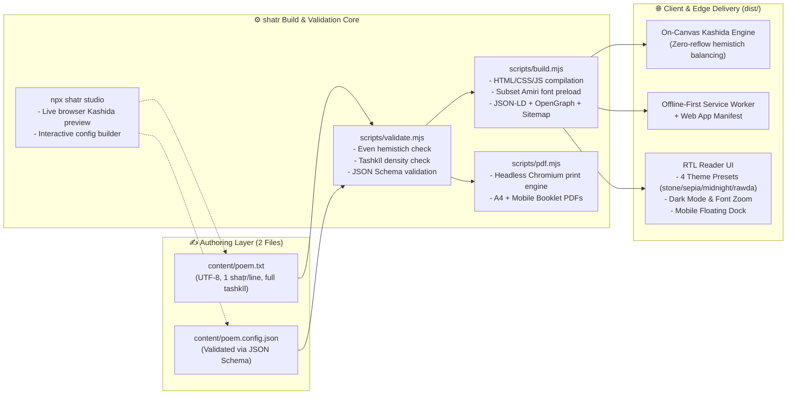

<div dir="rtl" align="center">

# شطر · `shatr` & `create-qasida`

</div>

<div align="center">

**Publish a Complete, 100/100-PageSpeed, Accessible Arabic Poetry Website & Print-Ready PDF Booklet from Plain Text**

[](https://nodejs.org)
[](#create-qasida--one-command-project-scaffolder)
[](https://hmittou.benjelloun.dev)
[](https://hmittou.benjelloun.dev)

**English** · [العربية](README.ar.md) · [Authoring Guide](AUTHORING.md) · [Config JSON Schema](schema/poem.config.schema.json)

[**🌐 Live Production Showcase: Mimiyyat Hmittou (hmittou.benjelloun.dev)**](https://hmittou.benjelloun.dev)

</div>

---

## 📌 Executive Overview

**`shatr` (شطر)** and its companion CLI scaffolder **`create-qasida`** form a zero-runtime-bloat static publishing toolkit designed specifically for classical and modern **vocalized Arabic poetry (*qaṣāʾid mushakkala*)**.

You author **only two files**:
1. **`content/poem.txt`** — UTF-8 plain text, one *shaṭr* (hemistich) per line, fully voweled (*tashkīl*), with `##` section headers.
2. **`content/poem.config.json`** — schema-validated metadata (title, author, domain, theme preset, audio/PDF links, dates, SEO).

From those two files, `shatr` compiles a **100/100 Lighthouse single-page web application** with automatic **on-canvas *kashida* (*tatwīl*) justification**, dark mode, live font zoom, a browser-based **Visual Studio (`npx shatr studio`)**, an installable **offline PWA**, full **`CreativeWork`/`Poem` JSON-LD**, and **print-ready A4 + mobile PDF booklets (`npx shatr pdf`)**.

> **📦 Public Architecture & Schema Showcase**: This repository documents the architecture, CLI interface, authoring specification ([`AUTHORING.md`](AUTHORING.md)), and JSON Schema ([`schema/poem.config.schema.json`](schema/poem.config.schema.json)) for the **`shatr`** engine and **`create-qasida`** scaffolder, alongside live production deployments.

---

## 🏗️ System Architecture & Publishing Pipeline



---

## 🚀 `create-qasida` — One-Command Project Scaffolder

**`create-qasida`** scaffolds a complete, ready-to-deploy Arabic poetry repository built on the `shatr` engine in a single command:

```bash
npm create qasida my-poem
# or:
npx create-qasida my-poem

cd my-poem
npm install
npm run studio      # Launch visual browser studio with live kashida preview
```

### `shatr` CLI Commands

```bash
npx shatr init      # Interactive (or piped/scriptable) scaffold of content/poem.config.json
npx shatr check     # Validate poem structure, hemistich parity, tashkīl density & JSON schema
npx shatr build     # Compile production static site into dist/
npx shatr preview   # Build + serve locally at http://localhost:8080
npx shatr studio    # Launch interactive visual authoring studio at http://localhost:8080/studio/
npx shatr pdf       # Export print-ready PDFs (A4 + mobile booklet) into content/
```

---

## ✨ Key Engineering Highlights

- **On-Canvas Kashida (*Tatwīl*) Justification**: Classical Arabic poetry requires every *bayt*'s two hemistichs (*ṣadr* and *ʿajuz*) to align to an identical visual width. Instead of triggering expensive DOM layout reflows, `shatr` measures glyph runs on an offscreen HTML5 `<canvas>` and inserts cursive *tatwīl* (`ـ`) extensions at linguistically valid connection points.
- **Deterministic Validation (`npx shatr check`)**: Fails fast in CI if any section has an odd number of hemistich lines (dangling *shaṭr*), validates `content/poem.config.json` against [`schema/poem.config.schema.json`](schema/poem.config.schema.json), and warns on under-vocalized lines.
- **100/100 Google PageSpeed & Strict Security**: Self-hosted subset `Amiri` web font with `font-display: swap` and preload hints, strict Content-Security-Policy (CSP), semantic ARIA landmarks, and reduced-motion support.
- **AI-Agent Native (`AGENTS.md` / `CLAUDE.md` / `GEMINI.md`)**: Every scaffolded project ships pre-configured instructions for Claude Code, Google Antigravity, Gemini CLI, Copilot, and Cursor so AI agents preserve vocalization (*tashkīl*) and poetic meter without corrupting verses.

---

## 🌐 Live Production Sites Powered by `shatr`

| Publication | Verses | Live URL | Source Repository |
|---|---|---|---|
| **القصيدة الميمية التوسلية** — Shaykh Ahmad Hmittou | **291 *abyāt*** (582 hemistichs) + scholarly biography, SoundCloud audio & print PDF | [**hmittou.benjelloun.dev**](https://hmittou.benjelloun.dev) | [`kmbenjel/hmittou`](https://github.com/kmbenjel/hmittou) |

---

## 📄 License

The `shatr` and `create-qasida` framework architecture and schemas are licensed under [MIT](LICENSE). Individual poem texts remain the copyright of their respective authors. Built by [Khalid Benjelloun](https://benjelloun.dev).
